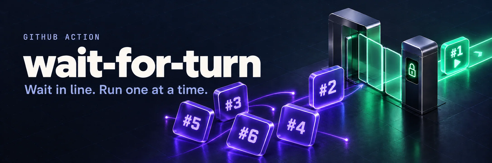
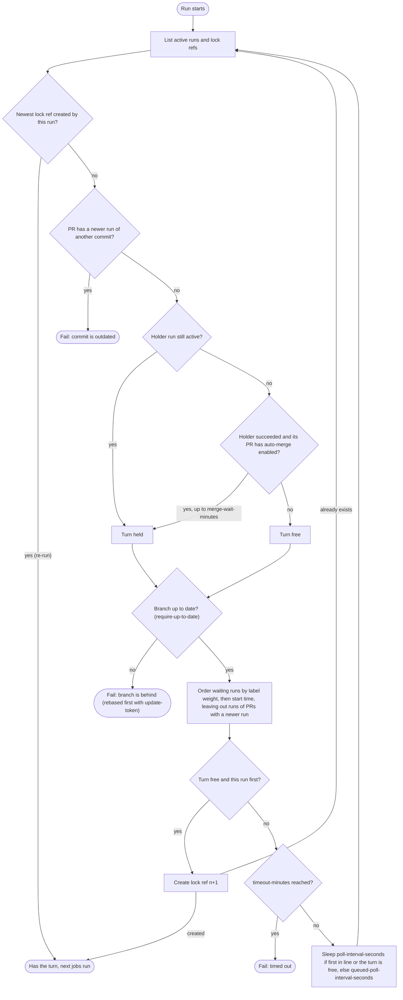
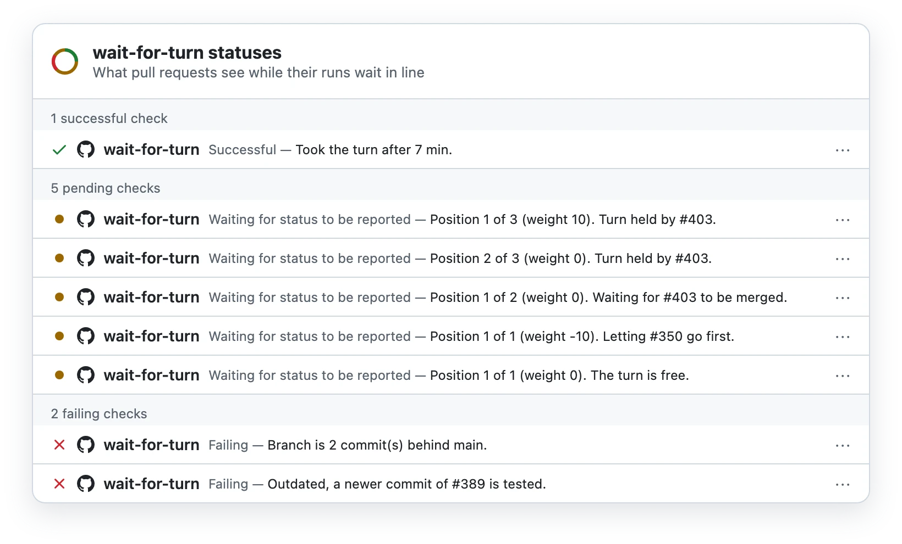

# wait-for-turn



[](https://github.com/udondan/wait-for-turn/releases/latest)
[](https://github.com/marketplace/actions/wait-for-turn)
[](https://github.com/udondan/wait-for-turn/actions/workflows/test.yml?query=branch%3Amain)
[](https://codecov.io/gh/udondan/wait-for-turn)
[](LICENSE)

GitHub Action that queues the runs of a workflow so only one run at a time uses shared resources (test stacks, environments), without cancelling pending runs the way a `concurrency` group does. Runs are ordered by the labels of their pull requests, so for example your own pull requests are tested before dependency updates, and release pull requests last. See [Alternatives](#alternatives) for when merge queue fits better.

## How it works

The run that has the turn holds the lock ref `refs/wait-for-turn/<workflow>/<n>`. The turn is released when that run completes, including all jobs after the wait, or, if its pull request is about to be auto-merged, after the merge (see [Outdated branches](#outdated-branches)). The next run takes the turn by creating ref `<n+1>`. Creating a ref fails if it already exists, so only one run can take the turn. Old lock refs are deleted.

Waiting runs are ordered by weight (highest first), then by start time. A re-run of the run holding the turn keeps it. A re-run of any other run queues by its new start time. A run of a pull request that has a newer run is left out of the queue: its commit is outdated, and it can stay active for a while after it stopped waiting, for example while other jobs finish after it failed as outdated. A waiting run fails as soon as its pull request has a newer run of another commit, so it never tests the outdated commit. To stop it right away instead of at its next check, add a `concurrency` group (see [Workflow setup](#workflow-setup)).

The run that is next in line checks every `poll-interval-seconds`, the other waiting runs every `queued-poll-interval-seconds`. This keeps the API requests low when many runs are waiting. While the turn is free, all waiting runs check every `poll-interval-seconds`, so the next run takes the turn quickly when the first one never does. Labels are read while waiting, so labelling a pull request moves its waiting run in the queue.

Active runs are read from the unfiltered run list. The `status` filter of the GitHub API is backed by a search index that can be stale and miss active runs (see [softprops/turnstyle#165](https://github.com/softprops/turnstyle/issues/165)).

Each waiting run repeats these steps until it has the turn:



## Usage

```yaml
jobs:
  wait-for-turn:
    runs-on: ubuntu-latest
    timeout-minutes: 180
    permissions:
      actions: read
      contents: write
      pull-requests: read
    concurrency:
      group: ${{ github.workflow }}-wait-${{ github.head_ref || github.ref }}
      cancel-in-progress: true
    steps:
      - uses: udondan/wait-for-turn@v1
        with:
          require-up-to-date: true
          label-weights: |
            autorelease: pending=-10
            renovate=-5

  deploy:
    needs: wait-for-turn
    if: ${{ !cancelled() }}
    runs-on: ubuntu-latest
    steps:
      - name: Check turn
        if: needs.wait-for-turn.result != 'success'
        run: exit 1
      # ...
```

All runs of the workflow must use this action, otherwise they don't take part in the queue. The `concurrency` group and the `Check turn` step are explained in [Workflow setup](#workflow-setup).

## Reusable workflow

The wait job can also be called as a [reusable workflow](https://docs.github.com/en/actions/sharing-automations/reusing-workflows), so the job settings are kept in one place instead of in every repository:

```yaml
jobs:
  wait-for-turn:
    permissions:
      actions: read
      contents: write
      pull-requests: read
      statuses: write
    uses: udondan/wait-for-turn/.github/workflows/wait-for-turn.yml@v1
    secrets:
      update-token: ${{ secrets.UPDATE_TOKEN }}

  deploy:
    needs: wait-for-turn
    # ...
```

It runs the action with a `concurrency` group that cancels outdated waiting runs (see [Workflow setup](#workflow-setup)) and queues on the calling workflow. The action comes from the same commit as the workflow file, so `@v1` follows every release of both. The calling job can still have its own `needs` and `if`, but no `runs-on` or `steps`. Its permissions are the most the called job gets, so grant them there. `statuses: write` is only needed for `status-context`. In the checks of a pull request, the job is shown as `wait-for-turn / Wait for turn`.

The inputs are the [inputs](#inputs) of the action, with the secrets `update-token` and `token`. Some defaults differ from the action's, to match the setup this README recommends:

| Name                     | Default of the workflow                      |
| ------------------------ | -------------------------------------------- |
| `label-weights`          | `autorelease: pending=-10` and `renovate=-5` |
| `no-pull-request-weight` | `-100`                                       |
| `timeout-minutes`        | `180`                                        |
| `require-up-to-date`     | `true`                                       |
| `status-context`         | `wait-for-turn`                              |

Pass `label-weights: ''` or `status-context: ''` under `with:` to turn them off.

## Inputs

| Name                           | Default                     | Description                                                                 |
| ------------------------------ | --------------------------- | --------------------------------------------------------------------------- |
| `workflow`                     | workflow of the current run | Workflow file name to queue on, e.g. `test.yml`.                            |
| `label-weights`                |                             | Priority by pull request label, one `label=weight` per line (see below).    |
| `no-pull-request-weight`       | `0`                         | Priority of runs without a pull request, e.g. a push to main (see below).   |
| `poll-interval-seconds`        | `30`                        | Seconds between checks of the run that is next in line.                     |
| `queued-poll-interval-seconds` | `300`                       | Seconds between checks of the other waiting runs while the turn is held.    |
| `timeout-minutes`              | `0`                         | Fail after waiting this many minutes. `0` waits indefinitely.               |
| `require-up-to-date`           | `false`                     | Fail if the PR branch is behind its base branch (see below).                |
| `merge-wait-minutes`           | `10`                        | Keep the turn held while the holder's PR is auto-merged (see below).        |
| `yield-to-pending-minutes`     | `10`                        | Let pending auto-merge PRs with a higher weight go first (see below).       |
| `update-pending-branches`      | `false`                     | Rebase pending auto-merge PRs with a higher weight that are behind (below). |
| `update-token`                 |                             | Token to rebase a PR branch that is behind (see below).                     |
| `status-context`               |                             | Context of a commit status showing the place in the queue (see below).      |
| `token`                        | `github.token`              | Token with `actions: read`, `contents: write` and `pull-requests: read`.    |

## Workflow setup

**Cancel outdated waiting runs.** A new commit on a branch makes the waiting run of the previous commit outdated. The action fails it at its next check, but until then it takes a runner. A `concurrency` group per branch with `cancel-in-progress` cancels it right away. Put the group on the wait job only, not on the workflow or the jobs after it: once a run has the turn, the wait job is done, so jobs that already use the shared resources are never cancelled and can always clean up.

**Fail the jobs after the wait when the wait fails.** When the wait fails, for example as outdated or on timeout, jobs that need it are skipped, and a skipped job counts as passed for required checks. Run them with `if: ${{ !cancelled() }}` and fail them in a first step when the wait didn't succeed, as in the example above. Or require a single job that checks all others:

```yaml
  required:
    needs: [wait-for-turn, deploy]
    if: always()
    runs-on: ubuntu-latest
    steps:
      - if: contains(needs.*.result, 'failure') || contains(needs.*.result, 'cancelled')
        run: exit 1
```

**Let other jobs wait as well.** Jobs that don't use the shared resources, like a build, can run without waiting. But then the runs of all open pull requests run them at once, and many are tested again after a rebase anyway. With few runners, let them wait for the turn as well.

## Priorities

A run's weight is the sum of the weights of its pull request's labels. Runs of pull requests without matching labels have weight 0. Runs without a pull request, for example of a push to main, have the weight `no-pull-request-weight`, 0 by default. Negative weights move runs to the back of the queue, positive weights to the front. With the example above, unlabelled pull requests are tested first, then Renovate updates (configure Renovate with `"labels": ["renovate"]`), and release-please pull requests (labelled `autorelease: pending`) last. A label like `urgent=10` lets you move a single pull request to the front.

To test main as well, but only after the pull requests, give runs without a pull request the lowest weight:

```yaml
on:
  pull_request:
    branches: [main]
  push:
    branches: [main]

# ...
      - uses: udondan/wait-for-turn@v1
        with:
          label-weights: |
            autorelease: pending=-10
            renovate=-5
          no-pull-request-weight: -100
```

The run of main then also lets pending pull requests go first after a merge (see [Outdated branches](#outdated-branches)).

The run holding the turn is never interrupted: a higher weight only affects which waiting run is next.

## Outdated branches

With branch protection requiring branches to be up to date, testing a branch that is behind its base branch is wasted time: it has to be updated and tested again. With `require-up-to-date: true`, the action fails as soon as the branch is behind, while waiting and right before taking the turn. An outdated run stops right away and makes room for the run of the updated branch.

Not every branch gets updated after a merge. release-please, for example, leaves its pull request alone when the merged commit doesn't change the changelog, so its runs would fail forever. With `update-token`, the action rebases a branch that is behind onto the base branch before failing, and the new commit starts a new run. Pushes made with `github.token` don't start workflow runs, so `update-token` has to be a personal access token or a GitHub App token with `contents: write` and `pull-requests: write`. Branches of forks are never updated.

```yaml
      - uses: udondan/wait-for-turn@v1
        with:
          require-up-to-date: true
          update-token: ${{ secrets.UPDATE_TOKEN }}
```

A successful run often gets its pull request merged by auto-merge, a few seconds after the run completes. A run taking the turn in between would pass the check and then test a branch that is outdated right after the merge. So when the run holding the turn succeeded and its pull request has auto-merge enabled, the turn stays held until the pull request is merged or closed, auto-merge is disabled, the branch turns out to be behind or conflicting, or a new commit was pushed to it. A new commit is merged only after its own run, which may be waiting for this turn. After the merge, the waiting runs fail as outdated. The wait ends after `merge-wait-minutes`, for example when another required check fails and auto-merge never merges. Pull requests you merge by hand can't be predicted: a run can still take the turn right before such a merge.

After a merge, the other pull requests are updated at different times. A release pull request, for example, is updated right away, while Renovate updates its branches a few minutes later. The run of the release pull request would be the only waiting run and take the turn, although it has the lowest weight. So before taking the turn, a run lets open pull requests with auto-merge enabled and a higher weight go first while they are about to be tested: their head commit has no run of the workflow yet. Pull requests whose head commit was already tested, successfully or not, don't hold up the queue, even when their branch is behind: nothing starts a new run for them until the branch is updated. The wait ends after `yield-to-pending-minutes`, for example when a run never starts.

With `update-pending-branches: true` and `update-token`, the waiting run also rebases such a pull request when its tested branch is behind, and lets the new commit go first. This keeps the order by weight after a merge, without waiting for the branch to be updated by someone else. It costs a run per rebase, also for a pull request whose tests fail: it is tested again each time its base branch moves on. Branches of forks are never updated.

```yaml
      - uses: udondan/wait-for-turn@v1
        with:
          require-up-to-date: true
          update-pending-branches: true
          update-token: ${{ secrets.UPDATE_TOKEN }}
```

## Queue status

The log shows the queue, but GitHub doesn't show the log of a composite action live, only after the step completed. With `status-context`, the action sets a commit status with that context on the head commit, visible live in the pull request's checks. It links to the run.

- pending while waiting, e.g. `Position 2 of 4 (weight -5). Turn held by #123.`
- success once the run took the turn
- failure when waiting failed, e.g. on timeout or an outdated branch, and error when the run was cancelled

<picture>
  <source media="(prefers-color-scheme: dark)" srcset=".github/statuses-dark.webp">
  
</picture>

The token needs `statuses: write`. Without it, the action logs a warning and waits without the status. A run killed before it can clean up leaves the status pending.

```yaml
    permissions:
      actions: read
      contents: write
      pull-requests: read
      statuses: write
    steps:
      - uses: udondan/wait-for-turn@v1
        with:
          status-context: wait-for-turn
```

## Alternatives

- **`concurrency` groups** run one run at a time, but keep only one pending run. A newer pending run cancels the older one, so pull requests that wait at the same time are not all tested. There is no order by priority.
- **[Merge queue](https://docs.github.com/en/repositories/configuring-branches-and-merges-in-your-repository/configuring-pull-request-merges/managing-a-merge-queue)** solves outdated branches at the source: it tests each pull request together with the ones ahead of it and merges it itself, so nothing has to be rebased or waited for after a merge. Combined with a `concurrency` group on the `merge_group` workflow, it also tests one pull request at a time. It is only available for repositories owned by organizations and orders pull requests by the time they were added (or moved to the front by hand), not by labels. If you can use it, prefer it over `require-up-to-date`, `merge-wait-minutes` and `yield-to-pending-minutes`.
- **Other queue actions**, like [softprops/turnstyle](https://github.com/softprops/turnstyle) or [ben-z/gh-action-mutex](https://github.com/ben-z/gh-action-mutex), run one run at a time, first come, first served.

This action is for repositories without merge queue, for example ones owned by a user, where runs share resources and some pull requests should go first. It adds the order by labels and the handling of outdated branches and auto-merge.

## Limitations

Pull requests from forks and from Dependabot get a read-only token and can't create the lock ref. The action then fails with a permission error. Skip the wait job for them instead:

```yaml
  wait-for-turn:
    if: github.event_name != 'pull_request' || (github.event.pull_request.head.repo.full_name == github.repository && github.actor != 'dependabot[bot]')
```

Jobs after it then have to treat a skipped wait as success, for example with `if: needs.wait-for-turn.result == 'failure' || needs.wait-for-turn.result == 'cancelled'` in the `Check turn` step. They don't get the secrets either, so skip the jobs that use the shared resources for them as well.
